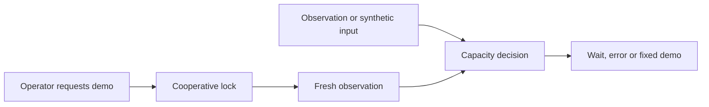

# Local AI Control Tower · Lite

**A small, inspectable demonstration of resource admission and cooperative exclusion for local AI workflows.**

Designed and directed by **Ignacio Adrián Lerer**. AI-assisted implementation.
Python 3.11+ · macOS / Linux · standard library only · MIT.

English | [Español](README.es.md)

## What is local AI, and why coordinate it?

In the usual cloud chatbot setup, a provider's computers run the model that generates the answer. With local AI, a compatible model runs on your own computer. Depending on the model and application, it can help draft text, summarize documents or review code. Some tasks can work offline after installation.

Local execution can give you more control over data processing and reduce dependence on an external service. It also makes the model compete with your other applications for memory and processing capacity. A downloaded model is not yet a reliable working tool.

This basic project demonstrates two mechanisms: an explicit capacity estimate and a shared lock for cooperating processes. It is intended for learning, reproducible experiments and discussion of the limits. It does not run models.

## One-minute quickstart

```sh
python3 -m unittest discover -s tests -v
python3 tower.py plan --available-gib 8 --reserve-gib 4 --request-gib 3
python3 tower.py plan --available-gib 6 --reserve-gib 4 --request-gib 3
python3 tower.py observe
```

The two plans use **synthetic inputs**, not measurements of your machine. The first returns `ELIGIBLE_ESTIMATE`; the second returns `WAIT_MEMORY` with a 1 GiB deficit. A refusal exits with code 2. `authorization: false` means that a calculation neither grants permission nor reserves memory.

To see cooperative exclusion, open two terminals in the same directory:

```sh
# Terminal 1: fixed waiting demo, without loading a model.
python3 tower.py demo --state-dir .state --reserve-gib 0 --request-gib 0 --hold-seconds 15
# Terminal 2, while the first displays DEMO_HOLDING_LOCK:
python3 tower.py demo --state-dir .state --reserve-gib 0 --request-gib 0
```

The second returns `BUSY` and exit code 3. When the first process finishes or dies, the operating system releases its lock. Zero values demonstrate the lock only; they are not a recommended inference policy. The demo runs no arbitrary commands, models or network requests.

## Actual scope

| Mechanism | This version |
|---|---|
| Capacity calculation | Integer bytes, explicit GiB, rejection of invalid inputs and observations older than five seconds |
| macOS memory | Only free pages reported by `vm_stat`; conservative and may reject viable workloads |
| Linux memory | `MemAvailable`; a kernel estimate, not a guarantee of allocation |
| Exclusion | Nonblocking `flock` on one private file shared by participants |
| Verification | Deterministic tests and real Python processes, without inference |
| Models, GPU, queues, adapters | Outside this version |
| MCP | Interface proposal; no server implemented |
| Skill | Advisory candidate; not installed or behaviorally validated across assistants |

## Architecture



`plan` is a query and does not acquire the lock. `demo` acquires it before observing memory and holds it during its fixed wait. There is no persistent service, telemetry, download or paid dependency.

## Safety and usefulness limits

This is **not a sandbox, a hard RAM limit or a machine-wide scheduler**. Other programs can ignore the lock or consume memory after an observation. All participants must share the same lock file; different directories create independent locks. The operating-system user is the trust boundary. Use private local storage, not a shared directory or network drive.

A model's download size does not determine the memory required for inference. Demand must be estimated or measured for the particular model, context and runtime. This project does not calculate that demand or prove that a model fits. It does not modify services, unload other workloads or turn a failed observation into an idle state.

The tests establish these basic mechanisms, not response quality, financial savings or assistant integration. See [verification](docs/verification.md), the [MCP proposal](docs/mcp.md) and the [candidate skill](skills/local-ai-run-readiness/SKILL.md).

## Development

Run the tests using the standard library. Contributions that change an admission condition should include a rejection or recovery test. Do not attach private prompts, conversations, client files or credentials to issue reports.

This is a general-purpose project. It does not provide legal advice or validate AI-generated content. See [SECURITY.md](SECURITY.md) for vulnerability reporting.
