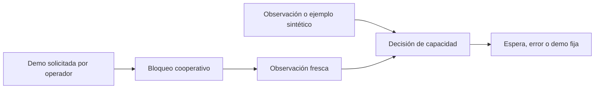

# Local AI Control Tower · Lite

**A small, inspectable demonstration of resource admission and cooperative exclusion for local AI workflows.**

Designed and directed by **Ignacio Adrián Lerer**. AI-assisted implementation.
Python 3.11+ · macOS / Linux · standard library only · MIT.

Un modelo descargado todavía necesita un entorno que pueda ejecutarlo. Esta versión básica permite estudiar dos mecanismos: una decisión explícita de capacidad y un bloqueo compartido entre procesos cooperativos. Está pensada para aprender, reproducir los controles y discutir sus límites.

## Prueba en un minuto

```sh
python3 -m unittest discover -s tests -v
python3 tower.py plan --available-gib 8 --reserve-gib 4 --request-gib 3
python3 tower.py plan --available-gib 6 --reserve-gib 4 --request-gib 3
python3 tower.py observe
```

Los dos primeros planes usan datos **sintéticos**, sin consultar su equipo: el primero devuelve `ELIGIBLE_ESTIMATE`; el segundo, `WAIT_MEMORY` y un déficit de 1 GiB. Un rechazo devuelve código 2. `authorization: false` recuerda que un cálculo no concede permiso ni reserva memoria.

Para observar la exclusión, abra dos terminales en el mismo directorio:

```sh
# Terminal 1: demostración fija de espera, sin cargar modelos.
python3 tower.py demo --state-dir .state --reserve-gib 0 --request-gib 0 --hold-seconds 15
# Terminal 2, mientras la primera muestra DEMO_HOLDING_LOCK:
python3 tower.py demo --state-dir .state --reserve-gib 0 --request-gib 0
```

La segunda devuelve `BUSY` y código 3. Al terminar o morir el primer proceso, el sistema operativo libera su bloqueo. Los valores cero sirven exclusivamente para mostrar el bloqueo; no son una política recomendada para inferencia. No se ejecutan comandos arbitrarios, modelos ni llamadas de red.

## Alcance real

| Mecanismo | Esta versión |
|---|---|
| Cálculo de margen | Enteros en bytes, GiB explícitos, rechazo de datos inválidos y observaciones de más de cinco segundos |
| Memoria en macOS | Sólo páginas libres de `vm_stat`; criterio conservador, puede rechazar cargas viables |
| Memoria en Linux | `MemAvailable`; estimación del kernel, no garantía de asignación |
| Exclusión | `flock` no bloqueante sobre un archivo privado compartido por los participantes |
| Verificación | Pruebas deterministas y procesos Python reales, sin inferencias |
| Modelos, GPU, colas, adaptadores | Fuera de esta versión |
| MCP | Propuesta de interfaz, sin servidor implementado |
| Skill | Candidata documental para revisión; no instalada ni validada entre asistentes |

## Arquitectura



`plan` es una consulta y no adquiere el bloqueo. `demo` lo adquiere antes de observar y lo conserva durante su espera fija. No hay servicio persistente, telemetría, descargas ni dependencias de pago.

## Límites de seguridad y utilidad

Esto **no es un sandbox, un límite duro de RAM ni un planificador global**. Otros programas pueden ignorar el bloqueo o consumir memoria después de la observación. Todos los participantes deben compartir el mismo archivo; usar carpetas distintas crea bloqueos independientes. El usuario del sistema operativo es la frontera de confianza. Use almacenamiento local privado, no una carpeta compartida o una unidad de red.

El tamaño de una descarga no determina la memoria requerida por una inferencia. La solicitud debe estimarse o medirse para el modelo, contexto y motor concretos. Este proyecto no calcula esa demanda ni prueba que un modelo quepa. No modifica servicios, no descarga de memoria trabajos ajenos y no intenta recuperar una observación fallida inventando un estado libre.

Las pruebas acreditan estos mecanismos básicos, no calidad de respuestas, ahorro económico ni integración con un asistente. Consulte [la verificación](docs/verification.md), [la propuesta MCP](docs/mcp.md) y [la skill candidata](skills/local-ai-run-readiness/SKILL.md).

## Desarrollo

Ejecute las pruebas con la biblioteca estándar. Las contribuciones deben incluir un caso de rechazo o recuperación cuando cambien una condición de admisión. No adjunte prompts privados, conversaciones, archivos de clientes ni credenciales a los informes de error.

Proyecto generalista: no presta asesoramiento jurídico ni valida el contenido producido por una IA. Para reportar una vulnerabilidad, vea [SECURITY.md](SECURITY.md).
